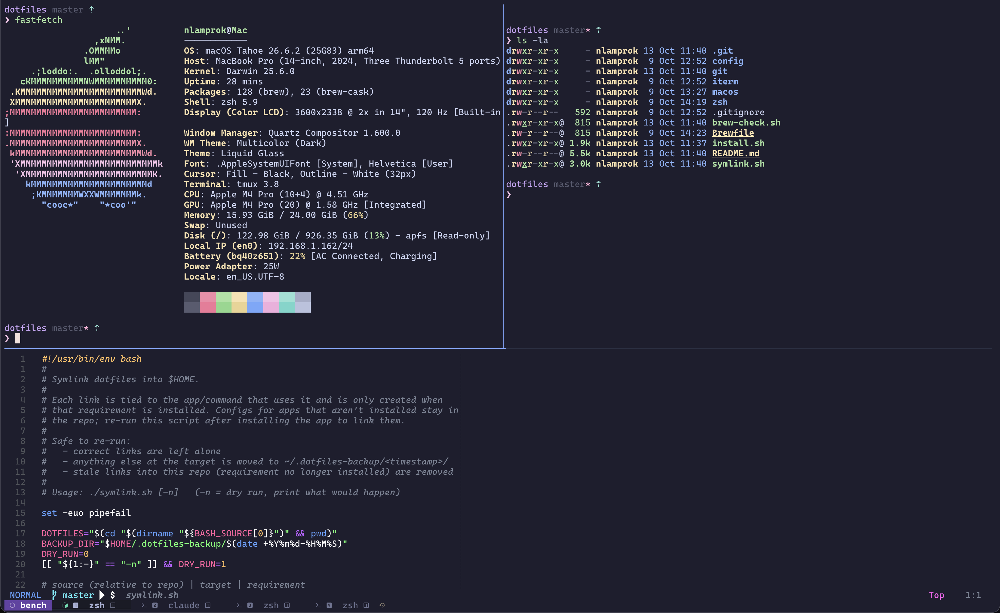

# nLamprok's Dotfiles



**This repo is primarily used as a backup to my personal dotfiles.
Don't use it unless you know what you're doing.**

## Setup

Clone into `~/dotfiles` (the `dots` alias in `.zshrc` expects it there) and run the installer:

```sh
git clone https://github.com/nLamprok/dotfiles.git ~/dotfiles
cd ~/dotfiles
./install.sh           # or ./install.sh --macos to also apply macOS defaults
```

`install.sh` is safe to re-run. It:

1. Installs the Xcode Command Line Tools (a GUI dialog; re-run the script once it's done)
2. Installs [Homebrew](https://brew.sh)
3. Runs `brew bundle --no-upgrade`: CLI tools, apps, fonts, and App Store apps via `mas` (sign in to the App Store first)
4. Runs `./symlink.sh` to link the configs into `$HOME`
5. Restores Neovim plugins pinned in `lazy-lock.json`
6. With `--macos`, applies `macos/macos` (log out and back in afterwards)

Then open a new terminal window. On first launch:

- **tmux** installs [TPM](https://github.com/tmux-plugins/tpm) and its plugins automatically (into `~/.tmux/plugins`). Afterwards `Prefix + I` installs new plugins and `Prefix + U` updates them. The prefix is `C-a`.
- **nvim** ([LazyVim](https://www.lazyvim.org)) builds its treesitter parsers and installs Mason tools in the background.

## What's in here

| Path                    | What                                                                       |
| ----------------------- | -------------------------------------------------------------------------- |
| `install.sh`            | Bootstraps a Mac from this repo                                            |
| `Brewfile`              | Formulae, casks, fonts and App Store apps (curated by hand)                |
| `symlink.sh`            | Links configs into `$HOME`, only for apps that are installed               |
| `brew-check.sh`         | Reports drift between this Mac and the `Brewfile`                          |
| `macos/macos`           | macOS `defaults` (keyboard, trackpad, Dock, Finder, shortcuts)             |
| `zsh/.zprofile`         | Homebrew environment and `SDKROOT` (see Troubleshooting)                   |
| `zsh/.zshrc`            | Aliases, PATH, fzf, nvm, starship, completions                             |
| `git/gitconfig`         | Git config with [delta](https://github.com/dandavison/delta)               |
| `git/gitignore_global`  | Global ignores: OS, editor and local env files only                        |
| `config/nvim`           | Neovim (LazyVim)                                                           |
| `config/tmux`           | tmux (prefix `C-a`, plugins via TPM)                                       |
| `config/ghostty`        | Ghostty terminal                                                           |
| `config/starship.toml`  | Starship prompt                                                            |
| `config/lazygit`        | lazygit, linked to `~/Library/Application Support/lazygit`                 |
| `config/btop`           | btop + Tokyo Night theme                                                   |

Configs for apps I don't currently use are kept around in case I come back to them:
`config/kitty`, `config/zed`, `config/alacritty`, `config/wezterm` and `config/zellij`.
`symlink.sh` links them automatically once the app is installed.

These need a manual import instead of a symlink:

- `iterm/`: iTerm2 profile and color schemes (Settings → Profiles → Import)
- `config/rectangle/RectangleConfig.json`: Rectangle (Settings → Import)

### Machine-specific config

Anything specific to one machine stays out of the repo. `~/.gitconfig` includes `~/.gitconfig.local` if it exists, e.g. to use a different email for repos in one folder:

```ini
# ~/.gitconfig.local
[includeIf "gitdir:~/Code/some-org/"]
	path = ~/.gitconfig-some-org   # contains [user] email = ...
```

### Node

`node` and `pnpm` come from Homebrew, so they're always available. For per-project Node versions, use [nvm](https://github.com/nvm-sh/nvm) (also from Homebrew; versions live in `~/.nvm` so they survive `brew upgrade`).

### Fonts

[CaskaydiaCove Nerd Font](https://www.nerdfonts.com/font-downloads) is installed from the `Brewfile` and used by Ghostty.

## Maintaining

Symlinks are in place, so editing a config is just a commit & push.

The `Brewfile` is curated by hand. Check for drift with:

```sh
./brew-check.sh
```

Then add or remove lines manually. Things to avoid:

- `brew bundle dump -f` regenerates the file and wipes manual curation.
- `brew bundle cleanup --force` uninstalls everything not in the `Brewfile`, including apps you installed outside it on purpose.

After installing or removing an app that has a config here, re-run `./symlink.sh` (`-n` for a dry run). Correct links are left alone, anything else at the target gets backed up to `~/.dotfiles-backup/<timestamp>/`, and stale links for uninstalled apps are removed.

## Troubleshooting

**`compinit`: "Ignore insecure directories and continue?"**: a Homebrew directory became group-writable:

```sh
chmod go-w "$(brew --prefix)/share"
```

**Treesitter: `ld: tapi error: malformed file ... unknown architecture arm64e.x1`**: Software Update installed Command Line Tools for a newer macOS, and its SDK can't be read by the current linker. `.zprofile` pins `SDKROOT` to the SDK matching the running macOS, so open a new terminal (and `tmux kill-server`) to pick it up.
